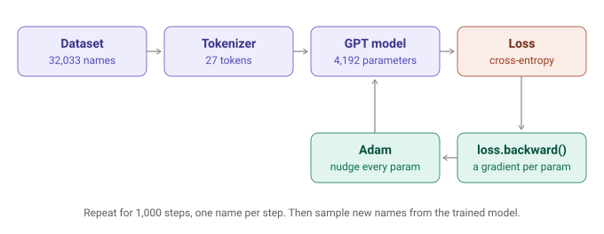
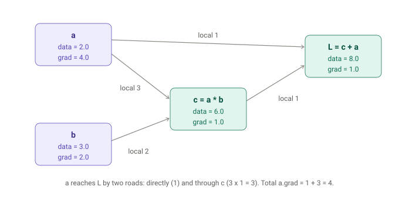
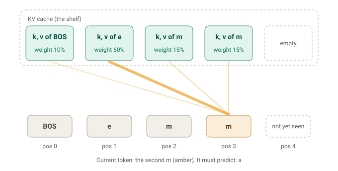
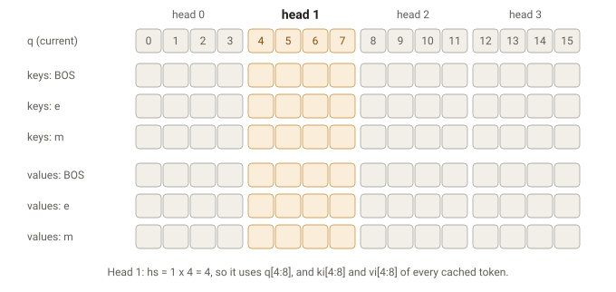
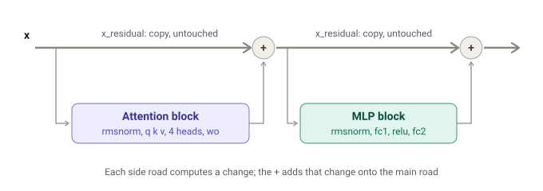

---

## Table of Contents

1. [What This Post Covers](#what-this-post-covers)
2. [The Big Picture](#the-big-picture)
3. [The Dataset](#the-dataset)
4. [The Tokenizer](#the-tokenizer)
5. [Autograd: The Value Class](#autograd-the-value-class)
6. [The Parameters](#the-parameters)
7. [Three Helper Functions](#three-helper-functions)
8. [The Model: Embeddings](#the-model-embeddings)
9. [Attention and the KV Cache](#attention-and-the-kv-cache)
10. [Multi-Head Attention, Line by Line](#multi-head-attention-line-by-line)
11. [Residual Connections](#residual-connections)
12. [The MLP Block and the Output](#the-mlp-block-and-the-output)
13. [The Training Loop](#the-training-loop)
14. [Inference: Generating Names](#inference-generating-names)
15. [KV Cache vs Causal Mask: The PyTorch Version](#kv-cache-vs-causal-mask-the-pytorch-version)
16. [microgpt vs a Production LLM](#microgpt-vs-a-production-llm)
17. [Summary](#summary)

---

## What This Post Covers

The previous post built up attention from scratch: tokens, embeddings, queries, keys, values, causal masking and multiple heads. This post puts all of it to work in a single, complete program.

[microgpt](https://gist.github.com/karpathy/8627fe009c40f57531cb18360106ce95) is a project by Andrej Karpathy: about 200 lines of plain Python, with no libraries at all, that trains a GPT and then uses it to generate text. Karpathy describes it in his [blog post](https://karpathy.github.io/2026/02/12/microgpt/) as the full algorithmic content of an LLM, with everything else being efficiency. It contains:

- a dataset and a tokenizer
- an autograd engine (the thing that computes gradients)
- a GPT-2 style transformer
- the Adam optimizer
- a training loop and an inference loop

We will walk through every part, top to bottom, with a running example: the name **"emma"**.

> **Note:** You can run the code yourself in Karpathy's [Google Colab notebook](https://colab.research.google.com/drive/1vyN5zo6rqUp_dYNbT4Yrco66zuWCZKoN?usp=sharing). It takes about a minute and needs no installs.

---

## The Big Picture

The whole file does one thing: **learn to predict the next character of a name, then use that skill to invent new names.**



Each training step takes one name, runs it through the model, measures how wrong the predictions were (the loss), works out which way to nudge each of the 4,192 parameters (the gradients), and nudges them (Adam). After 1,000 steps, the model has learned enough about names to generate new ones like "kamon", "karai" and "vialan".

From the model's point of view, a name is just a tiny document to be continued. A conversation with ChatGPT is the same thing at a much larger scale: a long document that the model continues one token at a time.

---

## The Dataset

```python
import os       # os.path.exists
import math     # math.log, math.exp
import random   # random.seed, random.choices, random.gauss, random.shuffle
random.seed(42) # Let there be order among chaos
```

Three built-in libraries, so nothing needs installing. `random.seed(42)` fixes the starting point of the random number generator, so every run produces the same "random" numbers and the same results.

```python
if not os.path.exists('input.txt'):
    import urllib.request
    names_url = 'https://raw.githubusercontent.com/karpathy/makemore/988aa59/names.txt'
    urllib.request.urlretrieve(names_url, 'input.txt')
docs = [line.strip() for line in open('input.txt') if line.strip()]
random.shuffle(docs)
print(f"num docs: {len(docs)}")
```

- If `input.txt` does not exist yet, download the list of names and save it.
- The list comprehension reads every line, strips off spaces and the newline character, and skips empty lines. `"emma\n"` becomes `"emma"`.
- `random.shuffle` mixes the order, because the file is sorted by popularity and we don't want the model to see all the common names first.

The result is `docs = ["emma", "olivia", "ava", ...]`, 32,033 names in total. Each name is one **document**.

---

## The Tokenizer

Neural networks work with numbers, not characters. The tokenizer converts between the two.

```python
uchars = sorted(set(''.join(docs)))  # ['a', 'b', ..., 'z']
BOS = len(uchars)                    # 26
vocab_size = len(uchars) + 1         # 27
```

Read the first line from the inside out:

1. `''.join(docs)` glues every name into one giant string.
2. `set(...)` keeps only the unique characters.
3. `sorted(...)` turns them into an ordered list.

A character's position in this list is its **token ID**: `a` is 0, `b` is 1, and so on up to `z` at 25. Encoding is `uchars.index('e')`, which gives 4. Decoding is `uchars[4]`, which gives `'e'`.

**BOS** (Beginning of Sequence) is a special extra token with ID 26. It marks where a name starts and ends:

```
"emma"  ->  [BOS, e, m, m, a, BOS]  ->  [26, 4, 12, 12, 0, 26]
```

BOS has two jobs. At the start, it gives the model something to look at when predicting the first letter. At the end, predicting BOS is how the model learns to say "this name is finished."

> **Note:** The numbers carry no meaning. The model never learns that 25 is bigger than 0. Each ID is only used to look up a row in a table, so the IDs could just as well be emoji.

---

## Autograd: The Value Class

This is the most important part of the file, and the hardest one to picture. We will build it up slowly.

### The Problem: Which Way to Turn Each Knob?

Training means adjusting the model's parameters so its predictions improve. For every parameter, we need to answer one question:

> If I turn this knob up a tiny bit, does the error (the loss) go up or down, and by how much?

That answer is called the **gradient**. Here is a model with just one knob, `w`. Its job is to turn `x = 2` into `6`. Its guess is `w * x`, and the loss is `(guess - 6)²`.

| w | guess | loss |
|---|---|---|
| 1.00 | 2.00 | 16.00 |
| 1.01 | 2.02 | 15.84 |

Turning `w` up by 0.01 lowered the loss by 0.16. So the loss changes about 16 times as fast as `w`, in the opposite direction.

That experiment works for one knob. microgpt has 4,192 knobs, and running an experiment on each one at every step would be far too slow. The `Value` class gets the answer to every experiment at once, without running any of them.

### A Value Is a Number That Keeps a Receipt

A normal Python number forgets where it came from. After `c = a * b`, `c` is just `6.0`. A `Value` remembers:

```python
class Value:
    __slots__ = ('data', 'grad', '_children', '_local_grads')

    def __init__(self, data, children=(), local_grads=()):
        self.data = data                # the number itself
        self.grad = 0                   # filled in later by backward()
        self._children = children       # the Values this one was made from
        self._local_grads = local_grads # how much I move per nudge of each child
```

| Field | Example for `c = a * b` | Plain English |
|---|---|---|
| `data` | 6.0 | the number itself |
| `_children` | (a, b) | "I was made from a and b" |
| `_local_grads` | (3.0, 2.0) | "nudge a by 1 and I move 3; nudge b by 1 and I move 2" |
| `grad` | 0 for now | how much the final loss cares about me |

`__slots__` is a memory optimization: it tells Python each `Value` has exactly these four fields. The program creates millions of these objects, so the saving matters.

### Every Operation Is a Lego Block

```python
def __add__(self, other):
    other = other if isinstance(other, Value) else Value(other)
    return Value(self.data + other.data, (self, other), (1, 1))

def __mul__(self, other):
    other = other if isinstance(other, Value) else Value(other)
    return Value(self.data * other.data, (self, other), (other.data, self.data))
```

When you write `a + b`, Python secretly calls `a.__add__(b)`. The first line wraps a plain number like `3` in a `Value`, so `a + 3` works too. The second line builds the result and records its receipt.

For multiplication, the local grads are swapped: nudging `a` moves `a * b` by `b`, and nudging `b` moves it by `a`. Check it with `a = 2`, `b = 3`: change `a` to 3 and the product goes from 6 to 9, up by 3, which is `b`.

The full set of blocks:

| Operation | Forward | Local gradient |
|---|---|---|
| `a + b` | a + b | 1 and 1 |
| `a * b` | a × b | b and a |
| `a ** n` | aⁿ | n × aⁿ⁻¹ |
| `a.log()` | ln(a) | 1 / a |
| `a.exp()` | eᵃ | eᵃ |
| `a.relu()` | max(0, a) | 1 if a > 0, else 0 |

Everything else is built from these:

```python
def __neg__(self): return self * -1
def __radd__(self, other): return self + other
def __sub__(self, other): return self + (-other)
def __rsub__(self, other): return other + (-self)
def __rmul__(self, other): return self * other
def __truediv__(self, other): return self * other**-1
def __rtruediv__(self, other): return other * self**-1
```

Subtraction is adding a negative, and division is multiplying by a power of -1, so their gradients come for free. The "r" versions handle a plain number on the left. They matter more than they look: Python's `sum([v1, v2])` starts by computing `0 + v1`, and integers don't know how to add a `Value`, so Python falls back to `v1.__radd__(0)`. Without `__radd__`, every `sum(...)` in the file would crash.

### The Forward Pass Draws a Map

Every operation creates a new `Value` card that points back to its parents. Here is the graph for `L = a*b + a`, with the gradients already filled in:



The forward pass only draws this map. **No gradients exist yet when it finishes.** That is the job of `backward()`.

### The Backward Pass Is One Line, Repeated

```python
def backward(self):
    topo = []
    visited = set()
    def build_topo(v):
        if v not in visited:
            visited.add(v)
            for child in v._children:
                build_topo(child)
            topo.append(v)
    build_topo(self)
    self.grad = 1
    for v in reversed(topo):
        for child, local_grad in zip(v._children, v._local_grads):
            child.grad += local_grad * v.grad
```

It has two parts:

1. **`build_topo`** lists every node so that each node appears after the nodes it was built from. It visits a node's children first, then appends the node itself. `visited` makes sure a node used twice is only listed once.
2. **The loop** starts at the loss (`self.grad = 1`, because the loss changes one-for-one with itself) and walks the list in reverse, applying one rule:

```python
child.grad += local_grad * v.grad
```

In words: **my child's gradient is the arrow's local grad times my own gradient.** Two rules fall out of this:

- **Multiply along a path.** This is the chain rule. If gear A turns gear B three times as fast, and B turns C twice as fast, then A turns C six times as fast.
- **Add across paths.** That is why it's `+=` and not `=`. In the diagram above, `a` reaches `L` by two roads: directly (worth 1) and through `c` (worth 3 × 1 = 3). Its total gradient is 1 + 3 = 4.

Why the reversed order? A node can only pass its gradient on once its own gradient is complete, which means everything that uses it must be processed first. Walking backwards from the loss guarantees that.

### Watch It Run, Step by Step

The stepper below runs a tiny "neuron", `L = (x*w + b)²`, through the real `Value` code. Click **Next** to see each object get created in the forward pass, then watch the gradients trickle back in the backward pass.

<iframe id="value-stepper" src="/assets/widgets/value_backward_stepper.html" title="Value backward stepper" style="width:100%;height:760px;border:0;border-radius:12px;" loading="lazy"></iframe>
<script>
  window.addEventListener("message", function (e) {
    if (e.data && e.data.microgptWidget === "value-stepper") {
      document.getElementById("value-stepper").style.height = (e.data.height + 8) + "px";
    }
  });
</script>

---

## The Parameters

```python
n_layer = 1     # number of transformer blocks
n_embd = 16     # every token is represented by 16 numbers
block_size = 16 # longest sequence the model can handle
n_head = 4      # attention runs as 4 parallel heads
head_dim = n_embd // n_head  # 4 numbers per head
matrix = lambda nout, nin, std=0.08: [[Value(random.gauss(0, std)) for _ in range(nin)] for _ in range(nout)]
```

`matrix` builds a grid of `nout` rows and `nin` columns, each entry a small random number from a bell curve centered on 0. Starting random matters: if every weight started identical, they would all receive identical gradients and could never become different.

| Matrix | Shape | Count | Role |
|---|---|---|---|
| `wte` | 27 × 16 | 432 | token embeddings, one row per character |
| `wpe` | 16 × 16 | 256 | position embeddings, one row per position |
| `attn_wq`, `attn_wk`, `attn_wv`, `attn_wo` | 4 × (16 × 16) | 1,024 | attention projections |
| `mlp_fc1` | 64 × 16 | 1,024 | MLP expand, 16 to 64 |
| `mlp_fc2` | 16 × 64 | 1,024 | MLP shrink, 64 to 16 |
| `lm_head` | 27 × 16 | 432 | turns 16 numbers into 27 scores |
| **Total** | | **4,192** | |

```python
params = [p for mat in state_dict.values() for row in mat for p in row]
```

This flattens every matrix into one list so the optimizer can loop over all parameters. They are the same objects as in the matrices, not copies.

> **Note:** GPT-2 had 1.6 billion parameters. Modern LLMs have hundreds of billions. The structure is the same.

---

## Three Helper Functions

### linear: Matrix Times Vector

```python
def linear(x, w):
    return [sum(wi * xi for wi, xi in zip(wo, x)) for wo in w]
```

For each row of `w`, take the dot product with `x`. The output has one number per row:

```
w = [[1, 2],      x = [10, 20]
     [3, 4]]
row 1: 1*10 + 2*20 = 50
row 2: 3*10 + 4*20 = 110      ->  [50, 110]
```

### softmax: Scores to Probabilities

```python
def softmax(logits):
    max_val = max(val.data for val in logits)
    exps = [(val - max_val).exp() for val in logits]
    total = sum(exps)
    return [e / total for e in exps]
```

It exponentiates each score and divides by the total, so the results are positive and add up to 1. 

```
[2, 1, 0]  ->  [0.665, 0.245, 0.090]
```

### rmsnorm: Keep Numbers at a Sane Size

```python
def rmsnorm(x):
    ms = sum(xi * xi for xi in x) / len(x)
    scale = (ms + 1e-5) ** -0.5
    return [xi * scale for xi in x]
```

It divides a vector by its root-mean-square, so its numbers have a typical size of about 1. Without this, numbers can grow or shrink layer after layer until training breaks.

```
[3, 4]  ->  mean of squares = 12.5  ->  scale = 0.283  ->  [0.85, 1.13]
```

---

## The Model: Embeddings

The `gpt` function processes **one token at one position** and returns **27 scores** for what comes next.

```python
def gpt(token_id, pos_id, keys, values):
    tok_emb = state_dict['wte'][token_id] # token embedding
    pos_emb = state_dict['wpe'][pos_id]   # position embedding
    x = [t + p for t, p in zip(tok_emb, pos_emb)]
    x = rmsnorm(x)
```

A token ID like 4 can't be fed into arithmetic, so it looks up row 4 of `wte`: 16 learned numbers meaning "the letter e". The position looks up its own row in `wpe`. Adding the two gives a vector that encodes both **what** the token is and **where** it sits.

---

## Attention and the KV Cache

### Queries, Keys and Values

Each token turns its vector `x` into three new vectors, using three learned matrices:

```python
q = linear(x, state_dict[f'layer{li}.attn_wq'])  # query: what am I looking for?
k = linear(x, state_dict[f'layer{li}.attn_wk'])  # key: what do I contain?
v = linear(x, state_dict[f'layer{li}.attn_wv'])  # value: what do I pass along?
keys[li].append(k)
values[li].append(v)
```

The last two lines are the **KV cache**.

### The Problem the KV Cache Solves

microgpt reads a name **one token at a time**. Imagine reading "emma" through a window that shows a single letter. When you reach the second `m`, you can no longer see the `e`, yet you need it to guess that `a` comes next.

The fix is a notebook. Each time a letter is processed, it writes a note before moving on:

- the **key** is the note's title, used to judge "is this note relevant to me?"
- the **value** is the note's body, the information it hands over
- the **query** is the question the current letter is asking right now

Keys and values go on a shelf (the cache) and stay there. The query is used once and thrown away.



### What Attention Needs at Each Step

At position *t*, attention needs:

| Ingredient | Which tokens | Where it comes from |
|---|---|---|
| q (query) | only the current token | computed fresh, used once, discarded |
| k (keys) | every token from 0 to *t* | earlier ones from the cache, the current one just appended |
| v (values) | every token from 0 to *t* | earlier ones from the cache, the current one just appended |

That is the whole relationship: **attention is the calculation, and the KV cache is the storage it reads from.**

Caching is allowed because a token's key and value are computed only from that token's own vector. They never depend on tokens that come later, so the key for `e` computed at position 1 is still exactly right at position 4. The query is different: only the current token ever asks a question, so old queries are never needed again. That is why it's a **KV** cache and not a QKV cache.

### A Worked Example

Use tiny 2-number vectors. We have processed `BOS` and `e`, and now we are at the **first** `m` (position 2). Its key and value have just been added to the cache:

| Token | Key | Value |
|---|---|---|
| BOS | [0, 1] | [1, 0] |
| e | [1, 0] | [0, 2] |
| first m | [0.5, 0.5] | [1, 1] |

The first `m` has the query **q = [2, 0]**.

**Step 1: compare the query with every key** (dot product, divided by √2 ≈ 1.41):

- BOS: (2×0 + 0×1) / 1.41 = **0**
- e: (2×1 + 0×0) / 1.41 = **1.41**
- m: (2×0.5 + 0×0.5) / 1.41 = **0.71**

**Step 2: softmax turns the scores into weights:** BOS **14%**, e **58%**, m **28%**.

**Step 3: blend the values with those weights:**

```
0.14 * [1, 0] + 0.58 * [0, 2] + 0.28 * [1, 1] = [0.42, 1.44]
```

Two things to notice about that result:

- **It belongs to the first m**, not the second. The second `m` hasn't been processed yet.
- **It is not a letter.** It is a bundle of context ("there was an e earlier") that still has to go through the rest of the model before any prediction comes out:

```
[0.42, 1.44]     attention output (context gathered)
   |  wo + residual
   |  MLP + residual
   |  lm_head
27 scores        one per possible next token
   |  softmax
27 probabilities the model's guess, ideally favoring "m"
```

When the model moves on to the second `m`, it computes one new q, k and v, appends k and v to the cache (now 4 entries), and repeats the three steps. The three earlier rows are reused as they are. Even though it is the same letter, the second `m` gets a different query, because its position embedding is different.

---

## Multi-Head Attention, Line by Line

Here is the attention code in full:

```python
x_attn = []
for h in range(n_head):
    hs = h * head_dim
    q_h = q[hs:hs+head_dim]
    k_h = [ki[hs:hs+head_dim] for ki in keys[li]]
    v_h = [vi[hs:hs+head_dim] for vi in values[li]]
    attn_logits = [sum(q_h[j] * k_h[t][j] for j in range(head_dim)) / head_dim**0.5 for t in range(len(k_h))]
    attn_weights = softmax(attn_logits)
    head_out = [sum(attn_weights[t] * v_h[t][j] for t in range(len(v_h))) for j in range(head_dim)]
    x_attn.extend(head_out)
x = linear(x_attn, state_dict[f'layer{li}.attn_wo'])
```

### Slicing Into Heads

Instead of doing attention once with all 16 numbers, the code cuts q, k and v into 4 slices of 4 numbers and runs attention 4 times, once per slice. Each run is a **head**. Think of four people reading the same notebook, each asking their own question.



```python
hs = h * head_dim                                # 0, 4, 8, 12
q_h = q[hs:hs+head_dim]                          # my 4 numbers of the query
k_h = [ki[hs:hs+head_dim] for ki in keys[li]]    # my 4 numbers of every cached key
v_h = [vi[hs:hs+head_dim] for vi in values[li]]  # my 4 numbers of every cached value
```

`q[4:8]` is Python slicing: items 4, 5, 6 and 7, because the end index is not included.

### The Dense Lines, Unrolled

**Scores**, one per cached token:

```python
attn_logits = []
for t in range(len(k_h)):             # for each cached token
    score = 0
    for j in range(head_dim):         # dot product over 4 numbers
        score += q_h[j] * k_h[t][j]   # k_h[t][j] = token t's key, number j
    attn_logits.append(score / head_dim**0.5)
```

**Weights**: `attn_weights = softmax(attn_logits)`.

**Blend**, one output number at a time:

```python
head_out = []
for j in range(head_dim):             # build each of the 4 output numbers
    total = 0
    for t in range(len(v_h)):         # mix that number across all cached tokens
        total += attn_weights[t] * v_h[t][j]
    head_out.append(total)
```

Notice the loops swap places. A score needs all 4 numbers of **one token**, while a blended number needs one number from **all tokens**.

### A Worked Example for One Head

At the first `m`, with 3 tokens cached, one head sees:

| Token | k_h | v_h |
|---|---|---|
| BOS | [0, 1, 0, 1] | [1, 0, 0, 0] |
| e | [1, 0, 1, 0] | [0, 1, 0, 0] |
| m | [0.5, 0.5, 0.5, 0.5] | [0, 0, 1, 1] |

The query slice is `q_h = [1, 0, 1, 0]`.

- **Scores** (dot product, then divide by √4 = 2): BOS 0, e 1.0, m 0.5
- **Softmax:** BOS 0.19, e 0.51, m 0.31
- **Blend:** 0.19 × [1,0,0,0] + 0.51 × [0,1,0,0] + 0.31 × [0,0,1,1] = **[0.19, 0.51, 0.31, 0.31]**

The values were chosen so the weights show up directly in the output: this head's answer is "mostly e's information."

### Collecting the Heads and Mixing Them

`x_attn.extend(head_out)` appends each head's 4 numbers. After four heads, `x_attn` has 16 numbers again, laid out side by side. `attn_wo` is a 16 × 16 matrix that **mixes** them, so each output number can combine findings from every head.

---

## Residual Connections

```python
x = [a + b for a, b in zip(x, x_residual)]
```

`x_residual` is a copy of `x` saved just before the attention block. This line adds the attention result back onto it, number by number.

Picture `x` as a main road running through the layer. Each block is a side road: it takes a copy of `x`, works on it, and merges its result back in by addition.



The pattern is always the same three steps:

```python
x_residual = x                              # 1. save the main road
x = ...block work...                        # 2. the side road computes something
x = [a + b for a, b in zip(x, x_residual)]  # 3. merge: main road + change
```

With 3 numbers instead of 16:

```
x_residual   = [0.5, -1.0,  2.0]   x before the block
block output = [0.1,  0.3, -0.2]   what attention found
new x        = [0.6, -0.7,  1.8]   old x, slightly adjusted
```

The block doesn't replace `x`, it **nudges** it.

### Why Residuals Matter

**Each block only has to learn an edit.** Without the residual, the block would need to output a complete new representation that still remembers the original letter. With it, the block only outputs "what to add." If it has nothing useful to say, it can output roughly zeros and `x` passes through unharmed.
**Gradients get an express lane.** Remember that `a + b` has local grads `(1, 1)`. In `backward()`, the gradient flows into the `x_residual` copy completely unchanged, without squeezing through every multiply inside the block.

---

## The MLP Block and the Output

```python
x_residual = x
x = rmsnorm(x)
x = linear(x, state_dict[f'layer{li}.mlp_fc1'])  # 16 -> 64
x = [xi.relu() for xi in x]                      # negatives become 0
x = linear(x, state_dict[f'layer{li}.mlp_fc2'])  # 64 -> 16
x = [a + b for a, b in zip(x, x_residual)]       # second residual
```

- **`mlp_fc1`** expands 16 numbers to 64. Each of the 64 outputs acts as a detector for some learned pattern.
- **`relu`** switches off the detectors that didn't fire: `[1.2, -0.5, 0.3, -2.0]` becomes `[1.2, 0, 0.3, 0]`.
- **`mlp_fc2`** packs the results back into 16 numbers so they can be added.

> **Note:** Attention is **communication**: the current token gathers information from earlier tokens. The MLP is **computation**: each token processes what it now has, on its own. A transformer alternates the two.

Finally, the output:

```python
logits = linear(x, state_dict['lm_head'])
return logits
```

`lm_head` turns the final 16 numbers into 27 scores, one per possible next token. A higher score means "more likely next."

---

## The Training Loop

### Turning a Name Into Training Examples

```python
doc = docs[step % len(docs)]
tokens = [BOS] + [uchars.index(ch) for ch in doc] + [BOS]
n = min(block_size, len(tokens) - 1)
```

`"emma"` gives five prediction tasks:

| Position | Input | Must predict |
|---|---|---|
| 0 | BOS | e |
| 1 | e | m |
| 2 | m | m |
| 3 | m | a |
| 4 | a | BOS (end) |

### The Forward Pass and the Loss

```python
keys, values = [[] for _ in range(n_layer)], [[] for _ in range(n_layer)]
losses = []
for pos_id in range(n):
    token_id, target_id = tokens[pos_id], tokens[pos_id + 1]
    logits = gpt(token_id, pos_id, keys, values)
    probs = softmax(logits)
    loss_t = -probs[target_id].log()
    losses.append(loss_t)
loss = (1 / n) * sum(losses)
```

A fresh, empty KV cache is created for every name. At each position, the loss is the negative log of the probability the model gave the correct answer. This is **cross-entropy**, and it measures surprise:

| Probability on the right answer | Loss |
|---|---|
| 1.0 | 0 |
| 0.9 | 0.11 |
| 0.5 | 0.69 |
| 0.1 | 2.30 |
| 1/27 (random guessing) | 3.30 |

That's why training starts near 3.3 and ends near 2.4. The losses are averaged into a single `Value` that sits at the end of the whole computation graph.

### Backward and Adam

```python
loss.backward()

lr_t = learning_rate * (1 - step / num_steps)
for i, p in enumerate(params):
    m[i] = beta1 * m[i] + (1 - beta1) * p.grad
    v[i] = beta2 * v[i] + (1 - beta2) * p.grad ** 2
    m_hat = m[i] / (1 - beta1 ** (step + 1))
    v_hat = v[i] / (1 - beta2 ** (step + 1))
    p.data -= lr_t * m_hat / (v_hat ** 0.5 + eps_adam)
    p.grad = 0
```

`loss.backward()` fills in `.grad` for all 4,192 parameters. The loop after it is Karpathy's from-scratch implementation of the [Adam optimizer](https://arxiv.org/abs/1412.6980): it uses each parameter's gradient to nudge that parameter in the direction that lowers the loss, with a learning rate that shrinks from 0.01 toward 0 over training.

The last line, `p.grad = 0`, resets every gradient before the next step. Because `backward()` adds with `+=`, leftover gradients would otherwise pile up from one name to the next.

> **Note:** Adam's `v` buffer and the attention `v` (value) are completely different things that happen to share a name.

---

## Inference: Generating Names

```python
temperature = 0.5
for sample_idx in range(20):
    keys, values = [[] for _ in range(n_layer)], [[] for _ in range(n_layer)]
    token_id = BOS
    sample = []
    for pos_id in range(block_size):
        logits = gpt(token_id, pos_id, keys, values)
        probs = softmax([l / temperature for l in logits])
        token_id = random.choices(range(vocab_size), weights=[p.data for p in probs])[0]
        if token_id == BOS:
            break
        sample.append(uchars[token_id])
    print(f"sample {sample_idx+1:2d}: {''.join(sample)}")
```

Start with BOS and an empty cache. At each step, get the scores, divide them by the temperature, turn them into probabilities, and roll a weighted die. If the die lands on BOS, the name is finished. Otherwise, decode the letter, keep it, and feed it back in as the next input.

**Temperature** controls boldness. Using the scores `[2, 1, 0]`:

| Temperature | Probabilities | Effect |
|---|---|---|
| 1.0 | 0.665, 0.245, 0.090 | the model's natural distribution |
| 0.5 | 0.867, 0.117, 0.016 | sharper, safer choices |
| close to 0 | 1, 0, 0 | always the top choice |

---

## KV Cache vs Causal Mask: The PyTorch Version

With a library like PyTorch, microgpt shrinks to about 70 lines. Most of the shrinkage is replacing hand-written parts with built-ins:

| microgpt (pure Python) | PyTorch |
|---|---|
| `Value` class and `backward()` | every tensor tracks its history; `loss.backward()` is built in |
| `matrix` and `state_dict` | `nn.Embedding` and `nn.Linear` |
| `linear`, `softmax`, `rmsnorm` | `nn.Linear`, `F.softmax`, `F.rms_norm` |
| the per-head attention loop | `F.scaled_dot_product_attention` |
| the hand-written Adam loop | `torch.optim.Adam` |
| `-probs[target].log()` averaged by hand | `F.cross_entropy` |

The one real change is that PyTorch processes the whole name at once, as a table with one row per position. That would let every position see the future, so a **causal mask** blocks each row from looking at later columns:

```
              looks at:  BOS   e    m    m    a
position 0 (BOS)          Y    -    -    -    -
position 1 (e)            Y    Y    -    -    -
position 2 (m)            Y    Y    Y    -    -
position 3 (m)            Y    Y    Y    Y    -
position 4 (a)            Y    Y    Y    Y    Y
```

Each row is exactly what microgpt's shelf held at that step. The math is identical; the GPU just computes all the rows in parallel.

---

## microgpt vs a Production LLM

| Part | microgpt | Production LLM |
|---|---|---|
| Data | 32K names | trillions of tokens of web text, books and code |
| Tokenizer | 27 characters | BPE subwords, around 100K tokens |
| Autograd | scalar `Value` objects in Python | tensors on GPUs |
| Size | 4,192 parameters, 1 layer, width 16 | hundreds of billions of parameters, 100+ layers |
| Positions | learned position embeddings | RoPE |
| Training | one name per step | millions of tokens per step |
| After training | a base model that completes names | supervised fine-tuning and RL to become a chatbot |

None of these change the core loop: predict the next token, measure the surprise, trace the blame backwards, nudge every parameter.

---

## Summary

### The Pieces

| Piece | What It Does |
|---|---|
| **Tokenizer** | Maps characters to IDs, with BOS marking start and end |
| **Value** | A number that remembers how it was made |
| **backward()** | Walks the graph in reverse: `child.grad += local_grad * v.grad` |
| **Embeddings** | Turn a token ID and a position into 16 numbers |
| **Attention** | Lets the current token read earlier tokens' keys and values |
| **KV cache** | Stores keys and values so they're computed once |
| **Multi-head** | Splits attention into 4 independent 4-number slices |
| **Residual** | Adds each block's output onto the main road instead of replacing it |
| **MLP** | Per-token computation: expand, relu, shrink |
| **Adam** | Uses smoothed gradients to nudge every parameter |

All credit for microgpt goes to Andrej Karpathy. Read his [original post](https://karpathy.github.io/2026/02/12/microgpt/) and the [full source](https://gist.github.com/karpathy/8627fe009c40f57531cb18360106ce95).

---

*All images and diagrams in this post were made with the help of [Claude](https://claude.ai).*
