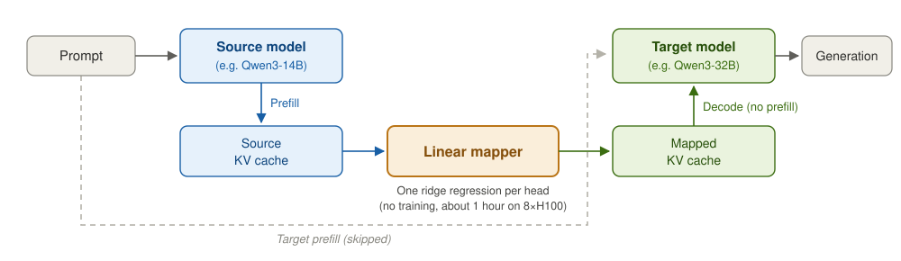
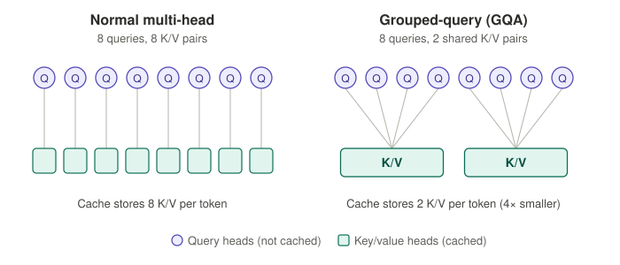
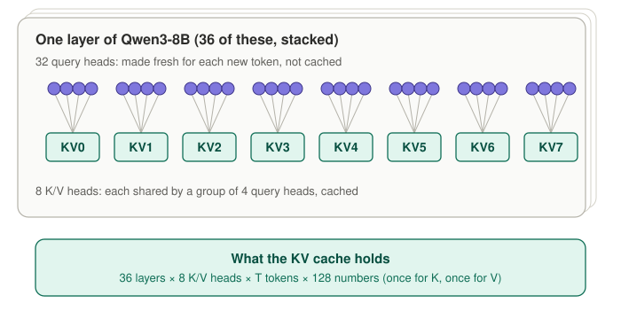
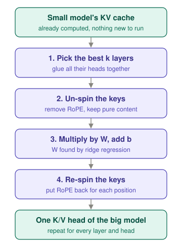
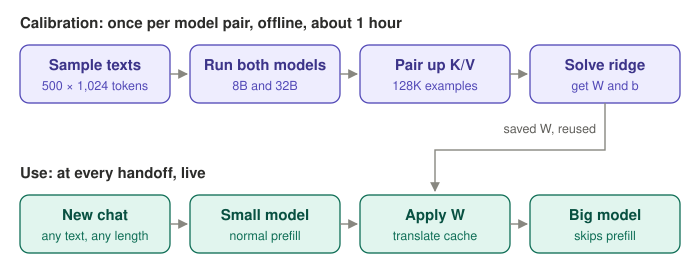

---

## Table of Contents

1. [What This Post Covers](#what-this-post-covers)
2. [The Big Picture](#the-big-picture)
3. [Background: Heads and GQA](#background-heads-and-gqa)
4. [Prefill and Decode](#prefill-and-decode)
5. [How Big Is the KV Cache?](#how-big-is-the-kv-cache)
6. [RoPE: Turning Position Into an Angle](#rope-turning-position-into-an-angle)
7. [The Problem: Every Switch Pays for Prefill Again](#the-problem-every-switch-pays-for-prefill-again)
8. [Is the Link Simple? A Straight-Line Test](#is-the-link-simple-a-straight-line-test)
9. [The Translator](#the-translator)
10. [Why Ridge and Not Plain OLS](#why-ridge-and-not-plain-ols)
11. [Calibration, Step by Step](#calibration-step-by-step)
12. [How They Tested](#how-they-tested)
13. [Results](#results)
14. [When a Straight Line Is Not Enough](#when-a-straight-line-is-not-enough)
15. [Summary](#summary)

---

## What This Post Covers

The last post walked through microgpt and showed where the KV cache comes from: every token writes a key and a value onto a shelf, and later tokens read from that shelf. This post asks a new question about that shelf:

> If a small model has already filled its shelf, can a bigger model read from it?

Normally the answer is no. The keys and values are made by one model's weights, so another model can't use them. The paper [Cross-Model KV Cache Transfer in LLM Families](https://arxiv.org/abs/2608.03893) by Taekyung Heo and colleagues at NVIDIA shows that, for models in the same family, you can convert one model's cache into the other's with a simple straight-line rule. The big model then skips reading the prompt and goes straight to writing.

We will cover:

- how attention heads and the KV cache are laid out in Qwen3
- what RoPE does to keys, and why the paper removes it
- how a straight-line fit (OLS) showed the idea could work
- the translator itself, and why it uses ridge regression
- what worked, what failed, and why

---

## The Big Picture



The small model (the **source**) reads the prompt as usual and builds its KV cache. A **linear mapper** converts that cache into the shape and meaning the big model (the **target**) expects. The big model then starts writing its answer from the converted cache. The dashed path, where the big model reads the whole prompt itself, is skipped.

The mapper is not a neural network. It is a set of weight tables found with one formula, with no training loop.

---

## Background: Heads and GQA

A layer has many heads. They all look at the same input, but each one learns to pick out different information.

### Attention Inside One Layer

Each token's hidden state is turned into a query (Q), a key (K) and a value (V). For each head, attention computes:

```
softmax(q · Kᵀ / √d) · V
```

The heads' outputs are glued together and projected back to the hidden size. This is the same thing microgpt did, just with bigger numbers.

### Grouped-Query Attention

Qwen3 uses **grouped-query attention** (GQA): many query heads share a smaller number of K/V heads.



In normal multi-head attention, every query head has its own key and value. In GQA, a group of query heads shares one key and one value. Queries are made fresh for each new token and thrown away, so only the K/V heads are cached. Fewer K/V heads means a smaller cache.

Qwen3-8B has **32 query heads** and **8 K/V heads**, each 128 numbers wide. So each K/V head serves 4 query heads:



---

## Prefill and Decode

Running a model on a prompt has two phases.

| Phase | What happens | What limits its speed |
|---|---|---|
| **Prefill** | One forward pass over the whole prompt (T tokens) at once. Every layer computes and stores K and V for every token. | Compute. Cost grows with model size × prompt length. |
| **Decode** | One new token at a time. Each new token computes only its own Q, K and V, adds its K and V to the cache, and attends over everything cached so far. | Memory speed. Reading the cache is the slow part. |

The key point for this post: **the output of prefill is the KV cache.** Once you have the cache, prefill's job is done.

---

## How Big Is the KV Cache?

Per layer, the cache holds K and V, each of shape `[T, 8, 128]`: T tokens, 8 K/V heads, 128 numbers per head.

For Qwen3-8B, per token:

```
36 layers × 2 (K and V) × 8 heads × 128 numbers × 2 bytes ≈ 144 KB
```

At 32K tokens, that is about **4.5 GB**. This is a lot of work to rebuild from scratch, which is exactly what happens every time you switch models.

---

## RoPE: Turning Position Into an Angle

### The Problem RoPE Solves

Attention compares a query with a key using a dot product, which roughly asks "how much do these two vectors point the same way?" On its own, that comparison has no idea where the words are. "Dog bites man" and "man bites dog" contain the same words, so without position information they would look the same. The model needs to know where each token sits.

### The Trick: Spin by Position

Picture each key and query as a clock hand. Before the comparison, every vector is spun by an amount that depends on its position:

| Position | Spin |
|---|---|
| 0 | none |
| 1 | a little |
| 2 | twice as much |
| 3 | three times as much |
| ... | and so on |

Say one hand turns 10° per position. A token at position 3 gets spun 30°. Since both the query and the key are spun, what matters when they are compared is **how far apart** they are, not where they sit in absolute terms.

### Pairs of Dimensions

A key isn't one clock hand. It's 128 numbers. RoPE treats them as **64 separate clock hands** (the numbers grouped in pairs) and spins each one at a different speed. Some spin fast and some spin very slowly, a bit like the second, minute and hour hands on a clock. Together they encode position at both fine and coarse scales.

### The Path a Key Takes in Qwen3

```
token's hidden state x
  → k_proj    multiply by a weight matrix   → raw key (content)
  → k_norm    resize to a standard scale    → normalized key (content)
  → RoPE      spin by position              → rotated key
  → stored in KV cache
```

The `k_norm` step is a Qwen3 detail called **QK-norm**. Qwen3 applies a small RMSNorm to each head's q and k before RoPE. If some keys or queries get huge, their dot products blow up and one token grabs all the attention. Normalizing first keeps everything on a similar scale. Each head gets its own normalization, which is why it's called "per-head".

So in Hugging Face transformers, the cached key is:

```
RoPE(k_norm(k_proj(x)))
```

### Why the Paper Strips RoPE

The cache stores keys **after** they've been spun. So a cached key mixes two things:

- **content**: what the word means, which is the direction the hand pointed before it was spun
- **position**: how far it got spun

The paper wants to learn a rule that turns one model's content into the other model's content, and it doesn't want position getting in the way. So it:

1. **un-spins** each source key (turns it backward by its position). This is "stripping RoPE". In our example, the token at position 3 is turned back 30°.
2. **maps** the pure content to the target model
3. **re-spins** the result by the same position before handing it to the target

When you strip RoPE from a Qwen3 key, what's left is the normalized content key, `k_norm(k_proj(x))`.

> **Note:** Values are never spun. They are never compared with anything. They are the payload that gets mixed together once attention has decided where to look. So values skip the un-spin and re-spin steps.

---

## The Problem: Every Switch Pays for Prefill Again

Real systems often switch between model sizes within one family:

- **Cascades:** try the small model first, and pass hard cases up to the big one.
- **Switching mid-conversation:** a chat moves to a different model partway through.
- **Routers:** each request is sent to whichever model fits best.

Every switch makes the receiving model prefill the whole context again. In long agent sessions, that context can be very large. Prefix caching doesn't help, because it only works within one model.

### The Reframe

Since prefill's output is the KV cache, the paper turns the problem around: if you can convert the source model's cache into the format the target expects, the target can skip prefill and go straight to decode.

More precisely, they want a function `f` that takes the source cache `C_S` and gives an estimated target cache `Ĉ_T`, so that the target does about as well decoding from `Ĉ_T` as from its own cache `C_T`.

### The Matched-KV Condition

The method needs the two models to have the **same number of K/V heads** and the **same head size**. The number of layers and the total size can differ. All six pairs in the paper have 8 K/V heads × 128 numbers per head.

---

## Is the Link Simple? A Straight-Line Test

Before building anything, the authors asked: is the relationship between the two caches simple?

### OLS: Drawing the Best Straight Line

**OLS** (ordinary least squares) is the formal name for "draw the best straight line through some points."

Say you have pairs of numbers, an input and an output, and you suspect the output is roughly a scaled, shifted version of the input:

```
output ≈ slope × input + intercept
```

Many lines could pass near the points. OLS picks the one that makes the **squared gaps** (the errors) as small as possible in total. Squaring keeps negative gaps from cancelling positive ones, and punishes big misses more.

In this paper, the pairs are: "when the small model's key looked like this, the big model's key looked like that." At this size, "straight line" means each of the big model's 128 output numbers is a weighted sum of the small model's input numbers. All those weights together form a table called **W**. There's a direct formula for the best W, so no training loop is needed.

### The Score: R²

R² measures how good the fit is:

| R² | Meaning |
|---|---|
| 1 | perfect |
| 0 | no better than always guessing the average |
| below 0 | worse than always guessing the average |

### The Experiment: A Heatmap

They fed the same text through both models. Then, for every pairing of a small-model layer with a big-model layer, they fitted a line and recorded the R². Laid out as a grid, rows are small-model layers, columns are big-model layers, and each square's colour is its score.

What the grid showed:

- **A bright diagonal.** A small-model layer about 40% of the way in best predicts the big-model layer about 40% of the way in. Both models process text in the same order of stages.
- **The scores are high.** The best squares reach R² ≈ 0.8, so a straight line captures most of the information.
- **Un-spinning the keys first makes the diagonal sharper.** Position was getting in the way of matching meaning.
- **Keys are easier to predict than values**, by about 0.2 R².
- **Several layers beat one layer.** For Qwen3 14B→32B:

| Source layers used | R² for K | R² for V |
|---|---|---|
| best single layer | 0.56 | 0.32 |
| best 8 layers combined | 0.79 | 0.65 |

So a straight-line translator is plausible, and it should read from several source layers at once.

---

## The Translator

The translator is not one big thing. It's many small ones: **one for every K/V head in every layer of the target model.** For 8B→32B, the target has 64 layers × 8 heads = 512 small translators for K, plus another 512 for V.

Each one does this:



In more detail:

```
For target layer L, head H, and every token:

1. PICK       choose the k source layers that best predict layer L (from the heatmap)
              glue together ALL 8 heads from each   →  k × 8 × 128 input numbers
2. UN-SPIN    remove RoPE from the source keys      →  pure meaning, no position
3. MULTIPLY   by the table W, add a bias b          →  128 output numbers
4. RE-SPIN    apply the target's RoPE for this token's position
              → this is the big model's key for (layer L, head H)

Values: same, but skip steps 2 and 4 (they were never spun).
```

Notice step 1 takes **all 8 heads** from each chosen source layer, not just the matching head. Head 3 in the small model doesn't have to line up with head 3 in the big model. The table W can pull from any of them.

The number of layers to combine, **k**, is chosen per model pair by trying every value from 1 up to "all" and keeping whichever scores best.

---

## Why Ridge and Not Plain OLS

W is found with **ridge regression**, which is OLS plus one rule: "prefer small weights." To see why that matters, here is a tiny example.

### Two Thermometers Side by Side

You want to predict a room's temperature from two thermometers, A and B, sitting right next to each other:

| Day | A | B | True temp |
|---|---|---|---|
| 1 | 20.0 | 20.1 | 20.0 |
| 2 | 25.0 | 24.9 | 25.0 |
| 3 | 18.0 | 18.0 | 18.0 |

**Many different rules fit these days equally well.** Because A ≈ B, any weights that add up to 1 give about the right answer:

```
Rule 1:    0.5 × A  +  0.5 × B    → day 1: 10.0 + 10.05 = 20.05    ✓
Rule 2:     10 × A  -    9 × B    → day 1: 200 - 180.9  = 19.1     ✓ roughly
Rule 3:   1000 × A  -  999 × B    → ...also roughly right
```

On these days the data can't tell the rules apart. The only thing separating them is the tiny difference between A and B, and that's just noise.

**OLS takes the noise seriously.** It hunts for the rule with the absolute smallest error, and the last little improvement comes from exploiting that noise, which needs huge weights like +1000 and −999. So OLS can end up picking a crazy rule.

### Then a New Day Arrives

A reads 22.0 and B reads 23.0. They differ a bit more than usual:

```
Rule 1:   0.5 × 22 + 0.5 × 23     =  22.5     sensible
Rule 2:   10 × 22 - 9 × 23        =  13       way off
Rule 3:   1000 × 22 - 999 × 23    = -977      nonsense
```

### Ridge's Fix: A Size Cost

Ridge adds a small cost for big weights. It adds up the squares of the weights:

```
Rule 1:   0.5² + 0.5²       =  0.5          cheap
Rule 3:   1000² + 999²      ≈  2,000,000    very expensive
```

Since the rules fit about equally well, the size cost breaks the tie, and ridge picks the calm Rule 1. The setting **λ = 0.01** says how much that cost counts. It's kept tiny so it only breaks ties and doesn't spoil the fit.

The formula is still direct, with no training loop:

```
W = (XᵀX + λI)⁻¹ XᵀY
```

### Where This Shows Up in the Paper

The translator's input glues together several neighbouring layers of the small model, say layers 10, 11 and 12. Neighbouring layers produce very similar keys, so they're the side-by-side thermometers. Except here, when k is large, there are over 12,000 input numbers instead of 2. Plain OLS would go unstable. Ridge keeps it calm.

> **Note:** Ridge is still a straight-line rule. It only picks a *calmer* straight line.

---

## Calibration, Step by Step

Finding W is called **calibration**. It happens once per model pair, offline. After that, W is reused for every handoff.



**Step 1: Gather sample texts.** 500 passages of 1,024 tokens each from FineWeb-Edu (educational web pages). This is the Rosetta Stone: the same text, seen by both models.

**Step 2: Run both models on the same texts.** A normal prefill on each, saving the full KV cache: every layer, every K/V head, every token.

**Step 3: Un-spin the keys from both models.** Remove RoPE so the keys hold only meaning, not position. That way W learns meaning only.

**Step 4: Keep every 4th token.** This gives about 128,000 matched pairs: for each kept token, the source's numbers and the target's numbers.

**Step 5: Choose which source layers feed each target layer.** For every (source layer, target layer) pairing, fit a quick straight line and record the R². That's the heatmap. For each target layer, keep the top k source layers.

**Step 6: Solve for W.** For every target layer and K/V head, separately for K and V:

| Piece | What it is |
|---|---|
| Input X | the chosen source layers' numbers for each token, glued together |
| Output Y | the target's 128 numbers for that head |
| Formula | W = (XᵀX + λI)⁻¹ XᵀY, plus a bias b |

**Step 7: Save W and b.** That's the finished translator: about 1 to 3 billion numbers, or 4 to 12 GB on disk.

The whole thing takes about **1 hour on one GPU server**, with no training. Once it's done, you never need the sample texts again. The translator works on any new text, of any length.

---

## How They Tested

The big model answers standard test questions in two ways:

- **Normally:** it reads the prompt itself.
- **Translated:** the small model reads the prompt, the translator converts the cache, and the big model answers from it.

The score is **retention**:

```
retention = translated accuracy ÷ normal accuracy
```

100% means nothing was lost.

The tests:

| Test | What it checks |
|---|---|
| ARC-Challenge | science questions |
| HellaSwag | pick the sensible ending to a scene |
| WinoGrande | work out what "it" or "they" refers to |
| MMLU | broad school and professional knowledge |
| GSM8K | multi-step maths word problems, where the model writes out its working |

---

## Results

| Pair (small → big) | Average retention | Maths (GSM8K) |
|---|---|---|
| Qwen3 14B → 32B | **97.6%** | 95.6% |
| Qwen3 8B → 32B | **87.5%** | 68.8% |
| Ministral 3B → 8B | 76.2% | 36.6% |
| Llama 3.1 8B → 70B | 72.8% | 18.2% |
| Ministral 3B → 14B | 44.2% | 3.2% |
| Ministral 8B → 14B | 41.6% | 1.6% |

What this shows:

- **Four pairs work (73% to 98%) and two fail badly.** Matching cache shapes helps, but it doesn't promise success.
- **Models closer in size translate better.** 14B→32B beats 8B→32B.
- **Multiple-choice tests hold up well; long maths answers don't.** A small error can be tolerated when picking one answer, but it adds up over many steps of written reasoning.

> **Note:** The point of all this is speed. The paper reports that converting the cache is about 2.7 to 25 times faster than re-running prefill. For a 32K-token cache going from Qwen3 14B to 32B, the transfer took about 0.28 seconds, compared to nearly 7 seconds for a fresh prefill.

---

## When a Straight Line Is Not Enough

The authors also tried a small MLP (a tiny neural network) as the translator, instead of a straight line.

**On the pairs that worked** (Qwen3, and Ministral 3B→8B), the link between the caches is already close to a straight line. Ridge fits it, and the MLP adds nothing. It was even slightly worse.

**On the failing pairs** (Ministral 8B→14B and 3B→14B), the link seems to bend. Ridge's straight line, fitted on the calibration text, went badly wrong on the test text: its R² there was −3.2 and −7.8, *much worse than just guessing the average*. The MLP followed the curve better. Just as important, it pushed its leftover errors into directions that attention doesn't pay much attention to, so those errors did less harm. On HellaSwag, retention went from 59% to 96% and from 68% to 92%.

So the straight line is the right tool when the two models think in similar ways, and a bent rule helps when they don't.

---

## Summary

### The Pieces

| Piece | What It Does |
|---|---|
| **GQA** | Many query heads share a few K/V heads, so only those few are cached |
| **Prefill** | Reads the whole prompt once; its output is the KV cache |
| **Decode** | Writes one token at a time, reading from the cache |
| **RoPE** | Spins keys and queries by position, so attention knows where tokens sit |
| **Stripping RoPE** | Un-spins keys so only meaning is left to translate |
| **OLS and R²** | A straight-line test that showed the two caches are closely linked |
| **Top-k layers** | Each target layer reads from the source layers that predict it best |
| **Ridge regression** | A straight-line fit that prefers small weights, so similar inputs don't cause wild results |
| **Calibration** | One hour, once per model pair: 500 texts in, W and b out |
| **Translator** | Pick layers, un-spin, multiply by W, re-spin: the big model skips prefill |

The big idea fits in one line: **prefill's output is the KV cache, so if you can translate the cache, you can skip the prefill.**

All credit for the method goes to Taekyung Heo and colleagues at NVIDIA. Read the [paper on arXiv](https://arxiv.org/abs/2608.03893).

---

*All images and diagrams in this post were made with the help of [Claude](https://claude.ai).*
