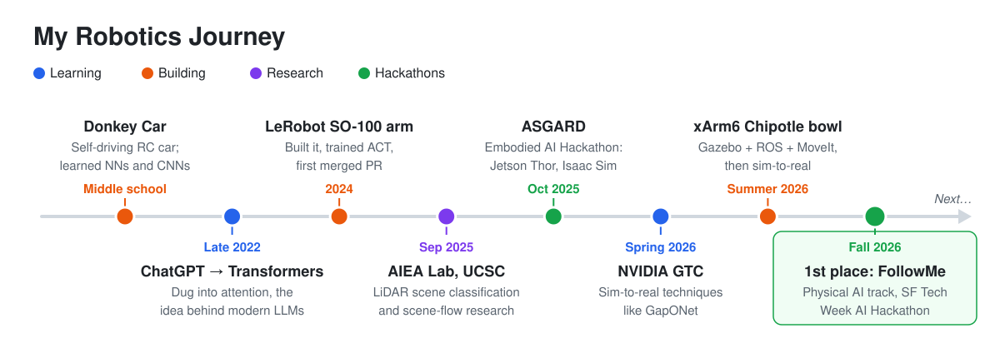

---

## Table of Contents

1. [My Journey at a Glance](#my-journey-at-a-glance)
2. [Where It Started](#where-it-started)
3. [Teaching a Toy Car to Drive Itself](#teaching-a-toy-car-to-drive-itself)
4. [Then ChatGPT Happened](#then-chatgpt-happened)
5. [LeRobot: My First Robot Arm](#lerobot-my-first-robot-arm)
6. [My First Hardware Hackathon](#my-first-hardware-hackathon)
7. [Research: Making Sense of LiDAR](#research-making-sense-of-lidar)
8. [Leveling Up: The xArm6 and a Chipotle-Style Bowl](#leveling-up-the-xarm6-and-a-chipotle-style-bowl)
9. [Still Going](#still-going)
10. [Summary](#summary)

---

## My Journey at a Glance

Every step on this timeline started the same way: I saw something that seemed like magic and needed to know how it actually worked.

---

## Where It Started

When I was a kid, robots were something out of the movies: machines that somehow just "knew" what to do. I lost count of how many times I rewatched *Enthiran*, a Tamil film about a scientist who builds a humanoid robot. Every time, I came away fascinated by the idea that someone could actually build one.

---

## Teaching a Toy Car to Drive Itself

In middle school I built a [Donkey Car](https://www.donkeycar.com/), a small open-source RC car, and trained it to drive around a track on its own. Watching it take its first lap without me was the moment I got hooked. I needed to know *how* a car could drive itself.

So I went looking. I took courses on autonomous driving and machine learning and learned about neural networks and convolutional neural networks (CNNs), the models that let the Donkey Car turn a camera image into a steering angle. Those courses gave me my foundations, and for the first time I understood why a car driving itself wasn't magic. It was math, data, and a lot of training.

---

## Then ChatGPT Happened

In late 2022, ChatGPT came out and took the world by storm. Other models followed fast:

| Model | Company | Released |
|---|---|---|
| ChatGPT | OpenAI | Nov 2022 |
| LLaMA | Meta | Feb 2023 |
| GPT-4 | OpenAI | Mar 2023 |
| Claude | Anthropic | Mar 2023 |
| Gemini | Google | Dec 2023 |

Once again, I was curious. That curiosity led me to the Transformer architecture and its **attention mechanism**, the idea that a model can learn which parts of its input to focus on. I found it fascinating, and I had no idea yet how much it would matter for robots.

---

## LeRobot: My First Robot Arm

In 2024 I discovered [LeRobot](https://github.com/huggingface/lerobot), Hugging Face's open-source robotics library and community. It was just getting started then, and today it's one of the best-known open robotics projects around. I knew immediately I had to try it.

I 3D-printed the parts for the [SO-100 arm](https://github.com/TheRobotStudio/SO-ARM100) (an open-source, low-cost arm designed by The Robot Studio) and ordered the servo motors, which took a painful two months to arrive. Putting the arm together, recording my first dataset by teleoperating it, and then training it to pick up carrots on its own was incredible.

As I had with the Donkey Car, I dug into how it actually worked, and I learned about [ACT, the Action Chunking Transformer](https://arxiv.org/abs/2304.13705). Sound familiar? It's the same Transformer idea behind ChatGPT and other LLMs, applied to robotics.

> **Note:** A language model predicts the next words. ACT predicts the next *chunk* of joint positions for the arm's motors. Same architecture, different output.

To get really comfortable with the codebase, I took on an issue in the LeRobot repo and submitted my first pull request, which got merged. After that, I kept reading through the repo whenever I could.

---

## My First Hardware Hackathon

In October 2025 I joined my first LeRobot hackathon: the 2025 Embodied AI Hackathon, hosted by Seeed Studio, NVIDIA, and Hugging Face in Mountain View. I'd done plenty of hackathons before, but never one with hardware, so I was thrilled.

Our team built [**ASGARD**](https://www.hackster.io/task-proxemics/asgard-a-jetson-thor-powered-task-proxemics-robot-afcca4), a home-assistant robot meant to help with everyday kitchen tasks like sorting groceries and setting the table. It paired a robot arm with vision-language-action (VLA) policies fine-tuned on our own demonstrations, ran on an NVIDIA Jetson Thor, and used a ReSpeaker microphone array so you could give it spoken commands. We also built a small classifier to tell when a person actually meant to take an object from the arm, which is the "task proxemics" part of the project.

Along the way I got hands-on with a lot of new things: I was introduced to NVIDIA Isaac Sim, worked on making the robot respond to audio through the ReSpeaker, and collected teleoperation data. We didn't place, but I learned a ton. I also met a great group of teammates who had flown in from Texas and worked in industry. Some were at Torc Robotics, and others attended and organized PyTorch community discussions at UT Austin. It was my first real taste of networking with people who build robots for a living.

---

## Research: Making Sense of LiDAR

During this time I was also doing research. Since September 2025, I've been an undergraduate researcher in the AI Explainability and Accountability (AIEA) Lab at UC Santa Cruz under Dr. Leilani Gilpin.

There I built a LiDAR scene-classification pipeline that labels each object's type, distance, and occlusion across **23,000+ frames** and **660,000+ object observations** from real vehicle and roadside sensors. The goal was to find scenarios that are under-represented in the data, so we know which ones to target with synthetic data when training 3D object detectors.

I've also been researching LiDAR motion-forecasting (scene flow) models, including NSFP, FastFlow3D, ZeroFlow, TrackFlow, and UniFlow. Scene flow is motion in 3D: for every point in a LiDAR scan, the model estimates where that point moves by the next scan. That tells a self-driving car which objects are moving, how fast, and in which direction. More about this in [my other post](LINK-TO-YOUR-SCENE-FLOW-POST).

---

## Leveling Up: The xArm6 and a Chipotle-Style Bowl

In summer 2026 I took a big leap and, with help from my family, invested in a UFactory xArm6, a six-axis industrial-grade arm.

### Hobby Arm vs Production Arm

The first thing I wanted to understand was what makes a production arm different from a hobby arm like the SO-100. The answer surprised me: less than I expected.

| | SO-100 (hobby) | xArm6 (production) |
|---|---|---|
| Joints | low-cost hobby servos | precision motors with harmonic-drive gearboxes |
| Structure | 3D-printed parts | engineered for stiffness |
| Result | great for learning | far more precise, stronger, smoother |
| Control, data, policies like ACT | **same ideas** | **same ideas** |

The big differences are in the hardware. Everything I'd learned about control, data collection, and policies like ACT still carried over from LeRobot.

That set me on a new quest: getting my xArm6 to assemble a Chipotle-style bowl by moving from one ingredient dispenser to the next.

### Simulation First

I started in Fusion 360, recreating the real workspace the arm would live in using the xArm6's official 3D models. I'd never done much CAD before, and this taught me how much an accurate simulation depends on accurate geometry. I wanted to build and test the whole workflow in simulation before touching the real robot. It's the safest way to experiment, and it's how I imagine it works in industry.

Once the workspace was in Gazebo, I learned ROS and a few key tools:

| Tool | What It Does |
|---|---|
| **ROS** (Robot Operating System) | the framework that lets all the pieces of a robot system (drivers, planners, sensors) talk to each other |
| **Gazebo** | a physics simulator where the virtual arm and workspace behave like the real thing |
| **MoveIt** | a motion planner: you say where the gripper should go, and it works out joint motions that get there without colliding with anything |
| **RViz** | a 3D visualizer for what the robot "thinks": its pose, planned paths, and sensor data |

### Then the Real Thing

After weeks of getting the simulation right, I finally felt ready to move to the real xArm6. On the first run, I was amazed at how well the simulation matched reality. It needed only minor corrections, and the arm actually put together a Chipotle bowl!

This project taught me a lot, but above all it taught me why **sim-to-real transfer** matters. Just a few months earlier, at NVIDIA GTC, I'd learned about techniques like [GapONet](https://neurips.cc/virtual/2025/124008), a neural network that learns the difference between how a robot's joints behave in simulation and how they behave in reality, and uses it to close that gap. Seeing my own sim-to-real transfer work made that lesson click.

---

## Still Going

I haven't stopped. Most recently, at the SF Tech Week AI Hackathon hosted at UC Santa Cruz, my team won **1st place in Physical AI** with [FollowMe](https://devpost.com/software/followme-amd-smart-phone-holder), an AMD-powered smart phone holder that tracks and follows you as you move. We built it on a LeRobot SO-101 arm. A camera feed tracks where the person is, and inverse kinematics turns that position into the joint angles that move the arm to keep the phone pointed at them.

I'm still learning something new about this field every day, and it's moving faster than ever. Next, I plan to keep running experiments and doing research in robotics, and to keep asking the same question that got me started with a little car on a track: *how does this actually work?*
